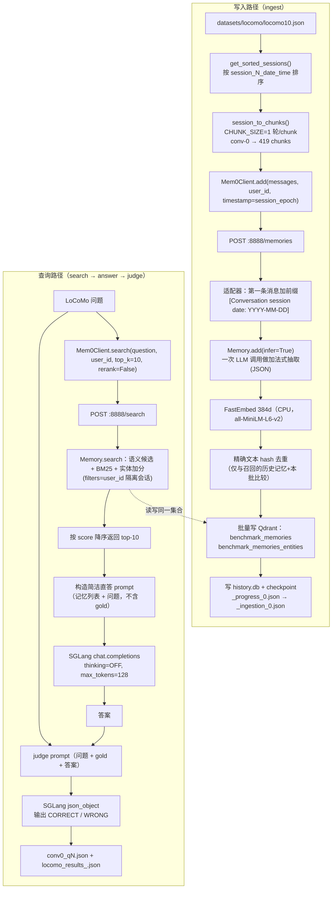

# 系统架构与执行流程（Mem0 + SGLang 长期记忆系统）

本文描述的是 **代码实际行为**，不是论文描述，也不是历史文档的复述。所有"已验证"
结论都来自 DGX Spark 上真实运行产生的结果文件或测量；未验证的会明确标注。

- 项目根目录：`/home/jiangchuan/mem0-reproduction`
- 平台：DGX Spark（GB10，ARM64，Ubuntu 24.04），单卡 TP=1
- 最近更新：2026-11-17（修复 ingest/predict 身份不一致、记忆库检查假绿灯、resume 半成品跳过等问题）

---

## 1. 组件与端口

| 组件 | 位置 | 端口 | 作用 |
|---|---|---|---|
| SGLang（Docker `jiangchuan-qwen38-zh`） | `model-serving/` | 127.0.0.1:8000 | 唯一 LLM 服务：抽取、回答、评判三处都调它 |
| Mem0 适配器（FastAPI） | `eval/local_mem0_server.py` | 127.0.0.1:8888 | 把 Mem0 SDK 包成 HTTP：`/memories` `/search` `/stats` `/export` `/health` |
| Qdrant（嵌入式） | `database/qdrant` | 文件锁，无端口 | 向量 + payload；集合 `benchmark_memories`、`benchmark_memories_entities` |
| SQLite | `database/history.db` | — | Mem0 的 `history` / `messages` 表（变更历史，不是原始对话备份） |
| 评测器 | `eval/run_locomo.py` → `eval/benchmarks/locomo/run.py` | — | ingest → search → answer → judge → 落盘 |

模型：`qwen3.8-27b-zh`，BF16，`max_model_len=32768`，`enable_thinking=false`（评测脚本显式传）。

依赖环境：
- `.benchmark-venv`：mem0ai 2.2.1、fastembed 0.9.1、qdrant-client 1.20.0、fastapi/uvicorn、aiolimiter —— eval/ 用这个
- `.venv`：numpy、psutil、spacy —— perf/ 性能实验用这个

---

## 2. 两条执行路径



同一张图的静态版本见 `docs/flow.svg`（可直接插进报告/PPT）。

---

## 3. 写入路径的逐步说明（含代码位置）

| 步 | 位置 | 输入 → 输出 |
|---|---|---|
| 1 | `run.py: get_sorted_sessions()` | `conversation.session_N*` → 按时间排序的 19 个 session |
| 2 | `run.py: session_to_chunks()` | turns → chunks（`CHUNK_SIZE = 1`，即一轮一轮送） |
| 3 | `run.py: locomo_date_to_epoch()` | `"1:56 pm on 8 May, 2023"` → Unix 时间戳 |
| 4 | `run.py: ingest_conversation()` | 逐 chunk POST，每个 chunk 成功即写 checkpoint |
| 5 | `local_mem0_server.py: add_memories()` | 时间戳 → `[Conversation session date: 2023-05-08]` 前缀拼进**第一条消息正文** |
| 6 | `mem0/memory/main.py: add()` | `infer=True`：一次 LLM 调用抽取 JSON；批量 embedding；hash 去重；批量 insert；写 history |

为什么把日期写进正文：OSS `Memory.add(timestamp=...)` 会直接抛
`ValueError("Platform-only temporal parameter. Not supported in OSS")`。
适配器因此把会话日期变成文本提示，而不是结构化时间字段。

副作用（解释结果时必须记住）：
- `payload.created_at` 是**入库时间**，不是历史事件时间；
- 抽取 prompt 里的 `Observation Date` 仍取当天日期，相对时间（"上周五"）的锚点
  依赖这段文本前缀，而不是可靠的字段。

---

## 4. 查询路径的逐步说明

1. `run.py: process_question()` 先 `mem0.search(question, user_id, top_k=10)`，同步阻塞，
   记录 `retrieval.search_latency_ms`。
2. 检索走 **Mem0 SDK 原生 `Memory.search`**：语义候选 + BM25 关键词 + 实体加分融合，
   `filters={"user_id": ...}` 做会话隔离。没有自定义 MMR，也没有实验侧的融合权重
   （旧 README 里的 "0.7/0.2/0.1" 在代码中不存在）。
3. `eval/run_locomo.py` 在导入期 monkey-patch 了 `prompts.get_answer_generation_prompt`，
   把官方 7 步扫描模板换成**简洁直答模板**（记忆列表 + 问题），并强制
   `enable_thinking=false`、`max_tokens=128`。
4. judge 保持官方实现（`response_format=json_object`，超过 100 token 的输入没问题；
   加 `extra_body` 反而会破坏 DGX 这个 SGLang 版本的 json_object）。
5. 每题结果落盘 `predicted_<project>/conv0_qN.json`；全部跑完再写
   `eval/results/locomo/locomo_results_<timestamp>.json`。

**默认不带 evidence 评判**：`run_locomo.sh` 不传 `--with-evidence`，judge 只看
问题 + 标准答案 + 生成答案。这是同模型自评，不是官方 LoCoMo 的 EM/F1。

---

## 5. 检索与推理的执行关系

- **串行**：`search` 完整返回后，才构造 prompt 并调用 LLM。两者之间没有流水线重叠，
  也没有"边检索边 prefill"。
- **一次请求一次回答**：152 题各自独立，不携带上一题的问答历史。
- **两个角色共用一个服务**：抽取（ingest）和回答/评判（eval）打的是同一个 SGLang，
  同一时刻只能有一个负载在跑；否则会互相拉长延迟（曾出现 generate 16671ms vs 干净
  8206ms 的 2 倍污染）。

---

## 6. 缓存与重复计算（实测）

| 现象 | 实测值 | 含义 |
|---|---|---|
| SGLang RadixAttention 前缀复用，完全重放 | `cached_tokens=1920/1966`（97.7%） | 缓存确实开启 |
| 记忆问答的真实前缀复用上限 | 约 **2.0%** 的 prompt token | 共享部分在 system header 之后即结束，每题注入的记忆块不同 |
| 抽取 prompt 的可复用部分 | 仅 ~8.4k token 的 system 段 | `## New Messages` 之后每 chunk 全变 |
| 记忆问答中重 prefill 的占比 | DGX 端到端延迟的 4.3% | LoCoMo 短问答几乎没有优化空间 |

另外：抽取 prompt 是**动态优先**排布
（`## Summary → ## Last k Messages → ## Recently Extracted Memories → ## Existing Memories → ## New Messages → 日期`），
重排它可以提高缓存命中，但会改变抽取质量，必须当作配对质量实验来做，不能当免费优化。

---

## 7. 与 Mem0 论文的差异（写报告时别混）

| 论文描述 | 已装 2.2.1 实际行为 |
|---|---|
| LLM 决策 ADD/UPDATE/DELETE/NOOP 循环 | **加法式抽取（ADD-only）**：召回 10 条历史记忆 + 本批，仅做精确文本 hash 去重，然后批量插入 |
| 记忆随时间演化、冲突消解 | 无自动 UPDATE/DELETE；显式 update/delete 方法存在，但 ingest 路径不调用 |
| 图记忆（实体关系） | `benchmark_memories_entities` 集合存实体，检索时做加分，不是图遍历推理 |

---

## 8. 复现命令（固定身份，一步到位）

```bash
cd ~/mem0-reproduction

# 0) 环境
scripts/setup/check_env.sh

# 1) 适配器（独占 Qdrant 文件锁，必须常驻）
mkdir -p logs
nohup scripts/server/start_mem0.sh > logs/mem0_adapter.log 2>&1 &

# 2) 写入：conv-0 全 19 个 session，419 个 chunk，约 1.5-2 小时，可断点续跑
scripts/eval/run_locomo.sh ingest

# 3) 备份记忆库（强烈建议，database/ 不进 git）
.benchmark-venv/bin/python scripts/debug/export_store.py export \
    --user-id locomo_0_task1_canonical --out database/exports/task1_canonical.json

# 4) 质量评测：152 题（先 smoke 10 题确认链路）
scripts/eval/run_locomo.sh smoke
scripts/eval/run_locomo.sh full

# 5) 看结果 / 看状态
scripts/eval/run_locomo.sh report
scripts/eval/run_locomo.sh status
```

固定身份（可用 `PROJECT_NAME` / `RUN_ID` 环境变量覆盖）：

| 项 | 值 |
|---|---|
| project / output 目录 | `task1_canonical` → `eval/results/locomo/predicted_task1_canonical/` |
| run_id | `task1_canonical` |
| Qdrant user_id | `locomo_0_task1_canonical` |
| 记忆条数 | 由 `/stats?user_id=...` 查询，不用目录判断 |

---

## 9. 已验证 / 未验证

| 项 | 状态 | 证据 |
|---|---|---|
| 写入→检索→回答→评判 全链路 | 已验证 | 152 题逐题结果 + 汇总 JSON（历史 run） |
| LoCoMo conv-0 152 题质量基线 | 已验证（历史 run，记忆库已丢失） | `locomo_results_20261116_212630.json`：123/152 = 80.9%，user_id `locomo_0_task1-dgx-sdk-20261116` |
| 分类别准确率 | 已验证 | temporal 89.2% (33/37)、single-hop 82.9% (58/70)、open-domain 76.9% (10/13)、multi-hop 68.8% (22/32) |
| 记忆条数与结果对应关系 | **已修复为可查** | 适配器 `/stats` 按 user_id 统计；`scripts/debug/store_inventory.py` |
| 缓存命中 / 成本系数 | 已验证（历史 trace） | `trace_results/`、`trace_results/task3_summary/report.md` |
| 中文检索质量 | 未验证 | embedding 用英文 all-MiniLM-L6-v2 |
| 官方 LoCoMo 评分（F1/EM） | 未做 | 当前是 LLM-as-judge 二元判定 |

---

## 10. 已知坑（会浪费半天的那种）

1. **不要用目录判断记忆库就绪**。库存在但没有本次 `user_id` 时，检索返回 0 条、
   准确率会莫名变低且无报错。用 `/stats`。
2. **不要混用 project 名**。checkpoint 和 user_id 都挂在 project/run_id 上；换名字
   等于从头 ingest 419 个 chunk。
3. **`--predict-only` 的产物没有 verdict**。若被 `--resume` 当成"已完成"就会跳过，
   最终汇总变成 0/N。已在 `run.py` 里改为只认带 `cutoff_results` 的文件。
4. **适配器独占 Qdrant 文件锁**。另开 `QdrantClient(path=...)` 会
   `RuntimeError: Storage folder ... already accessed by another instance`。
   盘点/导出请走 HTTP；直接读写前先停适配器。
5. **抽取阶段的 0 结果可能是上下文截断**。整个会话一次性送入会接近 32k 上限，
   抽取返回 `[]` 与"确实没内容"无法区分。当前按单轮（chunk_size=1）送，规避了这点。
6. **`max_tokens=64` 会截断 7 步扫描模板**，产生"看起来 20%"的假结果。当前用简洁
   直答模板 + 128 token，两者不能混用。
7. **runner 的 HTTP 超时必须大于一次抽取的最坏耗时**。适配器没有关闭 thinking，
   抽取输出上限 2048 token，DGX 解码约 4.5 token/s → 单个 chunk 最坏约 450s。
   旧的 300s 超时会让 runner "判失败并重试"，而适配器其实已经写库，于是同一条记忆
   被写两次（点 ID 是 uuid4，不会自动覆盖）。现默认 `MEM0_HTTP_TIMEOUT=900`，
   并用 `scripts/debug/check_duplicates.py` 校验文本层是否有重复。
8. **适配器被 Ctrl-C/`kill` 后可能仍占着 Qdrant 锁**：uvicorn 会等在处理中的
   抽取线程上，端口已经释放但 `.lock` 还被持有，表现为重启时报
   `Storage folder ... already accessed by another instance`。确认没有写入在进行后，
   对该 PID 用 `kill -KILL`，再启动适配器。
